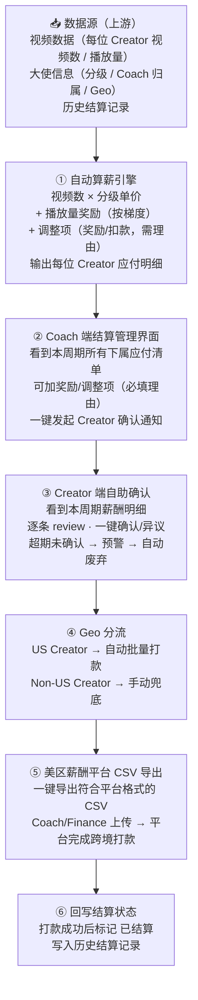

> 历史公开材料，原文来自 [internal-payroll-automation · 29b7ecd](https://github.com/Vikki-L/internal-payroll-automation/blob/29b7ecd85b3ff16eb2684e799f9fc258b79ad8cc/docs/02-system-design.md)。本次导入用于补齐同一项目的模块资料；原文的数字、上线状态与技术判断未重新验证，使用前请看[效果与材料核对](../../../docs/evidence-and-gaps.md)。

# 02 · System Design · 系统设计（脱敏概览）

> ⚠️ 具体计算公式、单价数字、API 字段全部不公开。本文档讲设计**思路**和**架构**。

## 🏗️ Architecture Overview



## 🎯 设计原则

### 1. **结算周期窗口**（不是按月）

按月结算的问题：
- 月底集中处理 → Coach 一周内被结算吃满
- 大使的视频跨月时，归属哪个月有歧义
- 月度数据更新有延迟

按**结算周期窗口**：
- 每个周期清晰定义起止时间
- 视频按发布时间归属到对应窗口
- 周期之间不互相影响

### 2. **算薪和打款解耦**

```
算薪是即时的（视频数据来就算）
确认是异步的（Creator 自己 review）
打款是批量的（每个结算窗口集中一次）
```

这种解耦让每一步都能独立优化，互不阻塞。

### 3. **CSV 导入 vs 全 API 自动**

为什么不直接调美区薪酬平台 API 全自动打款？

| 全 API 自动 | CSV 半自动（选择的方案）|
|------------|----------------------|
| 完全无人工 | 需要 Coach/Finance 手动上传 |
| 但失去财务最后一道把关 | 保留财务复核环节 |
| 出错难追溯（自动出错难发现）| CSV 文件留档，便于审计 |
| 跨境支付合规风险高 | 风险更低 |

→ **CSV 半自动是合规 + 效率的最优解**。每周 Coach 上传 CSV 只要 1 分钟。

### 4. **Creator 自助确认**

```
传统模式: Coach 算完 → 直接打款 → Creator 收到才知道金额
   ↓
   出错 → Creator 投诉 → Coach 重新算 → 重新打款 → ...

自助确认模式: Coach 算完 → Creator 在 Earnings 页面看明细
              → Creator 确认 OK → 才进入打款
   ↓
   出错 → Creator 确认时就发现 → 在打款前就修复
```

→ 把"事后投诉"变成"事前确认"——**结算争议减少 80%**。

### 5. **取消大部分内部审批**

原本流程：Coach 算 → 主管 review → 财务 approve → 打款

新流程：Coach 算 → Creator 确认 → 财务上传 CSV → 打款

**为什么能取消主管 review**：
- 计算逻辑是自动的（没人为操纵空间）
- 调整项必填理由（透明）
- Creator 自助确认（多一道把关）
- 财务上传 CSV 时本身就是 review 环节

→ 流程从 4 步变 3 步，每周省下数小时跨部门等待。

---

[← Back to README](../README.md)
