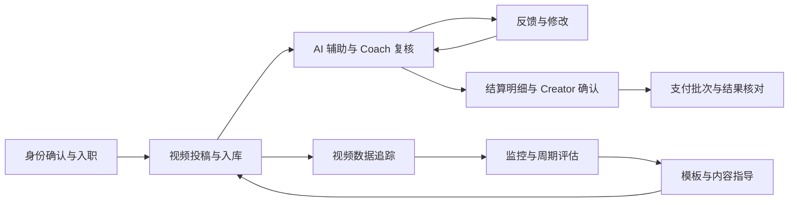

# Coach × Creator 双端协作系统

一个北美 AI 教育产品的**自营 UGC 运营系统**案例：围绕校园大使团队，把新人加入、视频投稿、Coach 审核、反馈、数据追踪和收入确认串成一条协作流程。

这是一项完整项目。视频审核、结算、评分、看板和 Bot 是其中的业务模块与配套能力；原先拆出的五个仓库，其公开设计资料现已收回本仓库统一组织。

本仓库提供产品设计案例、模块说明和脱敏示例。完整 PRD、原型、业务代码及原始数据保留在私有归档；本仓库不包含可部署的双端应用。历史效果数字的来源、冲突和证据缺口见[效果与材料核对](docs/evidence-and-gaps.md)。

## 要解决的问题

Creator 在 Slack / Discord 里提交链接、询问反馈和薪酬；Coach 在聊天记录、表格与多个工具之间核对。换一个 Coach 接手后，视频被怎样审核、Creator 改过什么、哪些内容应该进入结算，很难完整继承。

因此，系统设计围绕同一位 Creator、同一条视频和同一笔结算记录展开，让双方看到各自要完成的工作，并保留交接所需的历史。

## 两端怎样协作

| 环节 | Creator 侧 | Coach / 内部团队侧 |
|---|---|---|
| 加入 | 完成身份确认，了解任务与提交流程 | 接收新人、确认归属、处理入职异常 |
| 内容协作 | 提交视频或已发布链接，查看审核反馈 | 接收投稿、参考 AI 建议、完成复核 |
| 修改与跟进 | 根据反馈修改、补充材料 | 查看历史反馈，跟踪待处理事项 |
| 收入确认 | 查看本周期明细、确认或提出异议 | 核对有效视频、奖励和调整项，处理异议 |
| 支付跟踪 | 查看结算进展与历史 | 导出支付批次、核对支付结果、回写状态 |
| 持续培养 | 查看内容表现与模板参考 | 根据监控、周期评分及分析安排下一轮指导 |

图中表示业务关系；不同阶段的旧工具、Bot 和双端页面分期演进，不能据此认定所有模块曾同时在同一应用中上线。

## 从哪里开始读

| 想了解什么 | 阅读入口 |
|---|---|
| 系统全貌、角色与数据关系 | [系统总览](docs/system-overview.md) |
| 一条投稿如何走到反馈、确认与结算 | [端到端流程与交接](docs/workflows.md) |
| 14 个旧模块分别属于哪里 | [完整模块归属表](docs/module-map.md) |
| 关键产品设计取舍 | [设计决策](docs/design-decisions.md) |
| 哪些效果可引用、哪些还要核实 | [效果与材料核对](docs/evidence-and-gaps.md) |
| 五个独立仓库如何收拢、材料来自哪个版本 | [仓库整合与来源](docs/consolidation.md) |

## 按业务环节查看模块

| 业务环节 | 核心模块 | 配套能力 |
|---|---|---|
| 新人进入系统 | [C1 入职自动化](03-ai-workflow-automation/C1-onboarding-bot/) | [D2 入职漏斗分析](04-data-analysis-insights/D2-onboarding-analysis/) |
| 投稿、审核与反馈 | [B6 投稿入库](02-data-dashboards/B6-creator-submission-pipeline/)、[A1 双端审核](01-coach-creator-dual-platform/A1-videos-review/) | [A3 AI 审核与 badcase](01-coach-creator-dual-platform/A3-ai-video-review/) |
| 明细、确认与支付 | [A2 Coach 结算](01-coach-creator-dual-platform/A2-internal-payroll/) + [A6 Creator Earnings](01-coach-creator-dual-platform/A6-creator-earnings/) | 支付导出、异议与异常处理 |
| 日常跟进与培养 | [B1 日常监控](02-data-dashboards/B1-coach-daily-monitor/)、[B3 周期评分](02-data-dashboards/B3-ambassador-scoring/) | [C2 Coach 助手设计](03-ai-workflow-automation/C2-coach-assistant-bot/) |
| 内容策略迭代 | [B4 模板表现](02-data-dashboards/B4-template-dashboard/)、[B2 竞品监控](02-data-dashboards/B2-competitor-monitor/) | [D1 内容效果分析](04-data-analysis-insights/D1-video-effectiveness/)、[D3 评分方法来源](04-data-analysis-insights/D3-turbo-insights/) |

原 A/B/C/D 编号与目录继续保留，供历史引用和旧链接使用；它们是资料分类，不代表四个独立产品。

## 我负责的工作

根据已有公开案例，工作包括双端需求与原型设计、字段和状态衔接、结算边界条件、AI 审核 Prompt 与错误案例迭代、分析框架，以及开发和财务协作。各模块说明保留具体职责；团队协作成果与个人工作应结合原始材料说明。

过去版本列过服务规模、审核准确率和节省时间等结果。这些数字有口径差异，本次整理先集中保留[来源与待核实项](docs/evidence-and-gaps.md)，不把它们作为已重新验证的统一成效。

作者：[LIU Zibing / Vikki](https://github.com/Vikki-L)。资料整合日期：2026-11-12。
